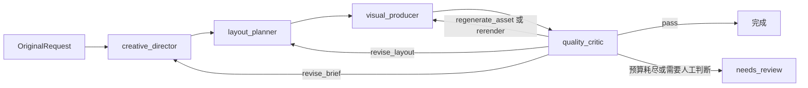

# Creative Poster Framework

Creative Poster Framework 提供海报生成任务的 Agent 接口、格式适配、运行记录、工具调用和返工管理。使用者负责选择模型服务、SDK、提示词和业务工具；框架负责运行身份、公共数据校验、依赖版本、文件引用、调用记录、预算与工作流路由。

## 四个角色



`creative_director` 整理创意方向，`layout_planner` 形成版式，`visual_producer` 生成图片候选，`quality_critic` 检查当前候选。返工按照审核提供的 `RevisionAction` 与 `VersionDependency` 路由，并受 `RunBudget.max_revision_rounds` 限制。

默认允许最多 4 轮返工；首次候选审核不计入返工轮数，因此最多审核 5 个候选。默认图像操作和 Critic 视觉调用额度各为 5 次，覆盖初始候选及最多 4 轮返工。调用方可以通过 `RunBudget` 调整这些额度。

## 安装

项目要求 Python 3.11 和 uv。安装运行依赖与开发测试依赖：

```bash
uv sync --locked --all-groups
```

## 运行完整演示

```bash
uv run python examples/four_role_walkthrough.py --root .scratch/framework-demo
```

该命令显式启用 `FakePosterModel`，执行四角色工作流和四种返工预算场景，并检查业务输出、当前候选审核、公开返工历史及角色路由。演示为各场景明确设置两轮返工额度，用于展示自定义预算；未传入 `RunBudget` 的工作流默认允许四轮返工。JSON 输出、运行记录和模型调用记录写入指定目录。模型等待时间默认为每次调用 15 秒；可通过 `--delay-seconds` 调整演示用等待时间。Fake 演示检查工作流路由和记录行为，不评价模型生成质量。

工作流的默认执行模式为 `ExecutionMode.real`。接入真实模型时，为每个角色提供 `AgentRegistration`，在 Agent 内部调用所选 SDK，并通过 `context.call_model()` 记录模型调用。PNG、JPEG 与 WebP 图片候选会经过解码、声明格式和 720×1280 尺寸校验。文本占位只在显式 Fake 演示中接受。

## 单角色接入

最小 Agent 实现 `Agent.run(inputs, context)` 并返回 `AgentOutput`：

```python
class CreativeBriefAgent:
    async def run(self, inputs: AgentInput, context: AgentContext) -> AgentOutput:
        request = context.original_request
        content = {
            "headline": request.keywords[0].text,
            "tone": "calm",
        }
        return AgentOutput(
            content=content,
            content_format=BRIEF_FORMAT,
        )
```

通过 `AgentRegistration` 声明角色、输入与输出格式、适配器和业务校验器。`run_single_agent_from_request()` 用于从原始需求执行单个 Agent；`run_single_agent_from_upstream()` 会读取上游运行记录、导出内容和文件引用，并将其作为当前 Agent 的输入。可运行样例位于 [`examples/single_role.py`](examples/single_role.py)，接口细节见[接口说明](docs/api.md)和[组员接入指南](docs/contributor-guide.md)。

单角色示例读取 [`examples/sample-request.json`](examples/sample-request.json)，其公共 `AgentOutput` 参考见 [`examples/sample-single-role-output.json`](examples/sample-single-role-output.json)。

运行单角色样例：

```bash
uv run python examples/single_role.py --root .scratch/single-role
```

该样例使用默认真实执行模式和确定性业务 Agent，不调用外部模型服务。完整的 Fake 工作流入口单独列在前一节。

## 混合 Agent 测试

一次 `PosterWorkflow` 可以组合真实 Agent 与成员自编的确定性测试 Agent。`AgentSet` 为四个角色分别接收 `AgentRegistration`；相邻角色的 `output_formats` 与 `input_formats` 必须相连，内容格式不同时通过 `ContentAdapter` 转换。可参考 [`examples/revision_actions.py`](examples/revision_actions.py)：其中四个 Agent 各自注册，在 `ExecutionMode.real` 下使用 Pillow PNG 检查完整返工路由。该样例的校验器要求 `title`、`keyword_texts`、`columns` 等业务字段，并通过 `revision_validator` 保留原始关键词或已批准标题；这些规则属于样例，成员按自身业务定义校验器。

真实图片候选或 Pillow 生成的图片候选使用 `ExecutionMode.real`。仅当 `visual_producer` 写入框架的 Fake JSON 候选时，才使用 `ExecutionMode.fake`。该模式不会阻止任何 Agent 内部的 SDK 或网络调用。内置 `FakePosterModel` 按固定四角色顺序记录 `_calls`，其 `quality_critic` 读取专用 JSON 候选，适合整套演示；单独替换其中一个角色时，这些记录检查会失效。单角色验证可使用前文所列的 `run_single_agent_from_request()` 或 `run_single_agent_from_upstream()`。

## 原始需求、记忆与返工

使用 `OriginalRequest.from_keywords(run_id, keywords, constraints)` 创建需求。框架会生成 `request_id` 和关键词编号；画布尺寸、约束及原始关键词会保存在运行记录中。完整工作流入口会生成 `run_id`，单角色入口由调用方提供 `OriginalRequest`。

每次运行都有独立的 `RunSession`、调用记录、文件目录、记忆、缓存和预算。Agent 可通过 `context.memory` 读取当前角色允许访问的记忆，通过 `context.files` 写入带用途和媒体类型的文件。使用 SDK 发起模型或图片操作时，应调用 `context.call_model()`，以便写入统一调用记录并执行预算检查。工具内部需要模型调用时，也应使用同一个 `AgentContext`。

角色笔记应声明其依据的产物编号和修订号。上游产物更新后，依据旧修订号的笔记不会进入默认记忆上下文；仍可通过已签发的引用读取历史笔记。接口和代码示例见[组员接入指南](docs/contributor-guide.md#角色笔记与版本依据)。

`quality_critic` 的审核应标明当前候选的 `candidate_id` 和 `candidate_revision`，并为每个原始关键词提供一个 `KeywordReviewResult`。框架会补充审核 Agent 的运行身份，并检查审核是否指向当前候选。返工目标引用框架生成的依赖版本；业务 Agent 不需要自行编造文件哈希或版本依赖。

A1 与 A2 的定向返工示例分别演示 `revise_brief` 和 `revise_layout`，并验证原始关键词、保留字段、候选审核身份和角色笔记版本：

```bash
uv run python examples/revision_actions.py --action revise_brief --root .scratch/revise-brief
uv run python examples/revision_actions.py --action revise_layout --root .scratch/revise-layout
```

示例使用默认 `real` 模式和 Pillow 生成的确定性 PNG，不连接外部模型服务；它验证工作流接口与图片文件检查，不评价海报的主观质量。

## 工具接入

通过 `ToolRegistry.register()` 注册带参数注解和返回类型注解的函数，并设置 `allowed_roles`。Agent 可以调用 `context.tools.available_tools()` 获取当前角色可用工具的名称、用途和参数 JSON Schema；目录来自本次运行开始时保存的注册快照。Agent 再通过 `await context.tools.call(name, arguments)` 执行所选工具。

```bash
uv run python examples/tool_catalog.py --root .scratch/tool-catalog
```

样例会运行真实工作流路由，并在 `layout_planner` 中读取工具目录、调用允许使用的工具，再检查调用结果和运行记录。

## 格式升级

使用 `ContentFormat` 标识业务内容格式及版本，使用 `ContentAdapter` 声明源格式、目标格式和转换函数。注册表会在 Agent 输入或输出边界执行转换、公共 JSON 检查和业务校验，并记录源内容、目标内容与来源信息。格式升级样例会把上游 v1 内容转换为下游 v2 输入，并让下游 Agent 实际消费转换结果：

```bash
uv run python examples/format_upgrade.py --root .scratch/format-upgrade
```

## 能力范围

- 框架提供四个海报 Agent 角色、单角色入口、格式转换、工具调用、版本依赖、文件安全检查、记忆、缓存、调用预算和运行记录。
- 模型服务、SDK、提示词、供应商重试策略和业务质量标准由接入方配置。
- `real` 模式会校验真实 PNG、JPEG、WebP 候选的文件解码、媒体类型、扩展名和尺寸。
- FakeModel 用于显式演示与测试。Fake 文本候选不会被 `real` 模式接受。
- 运行记录可以证明框架执行路径、调用、输入输出和文件身份；记录本身无法证明图片或文案具有主观质量。

## 文件说明

- `src/poster_framework/`：公开接口、工作流与运行组件。
- `tests/`：接口、运行时、工作流、演示和单角色行为测试。
- `examples/`：单角色、工具目录、格式升级、定向返工，以及配套请求输入和单角色输出参考。
- `docs/api.md`：公共数据结构与调用入口。
- `docs/contributor-guide.md`：Agent、工具、模型 SDK 和校验器接入说明。

## Visual Producer 实现

A3 的素材生成、准确文字渲染、缓存与指定素材返工已实现于 src/poster_visual_producer。D 盘 Conda 环境安装、离线验收样张、SDK 适配和组员接入说明见 [Visual Producer 使用与交接](docs/visual-producer.md)。

