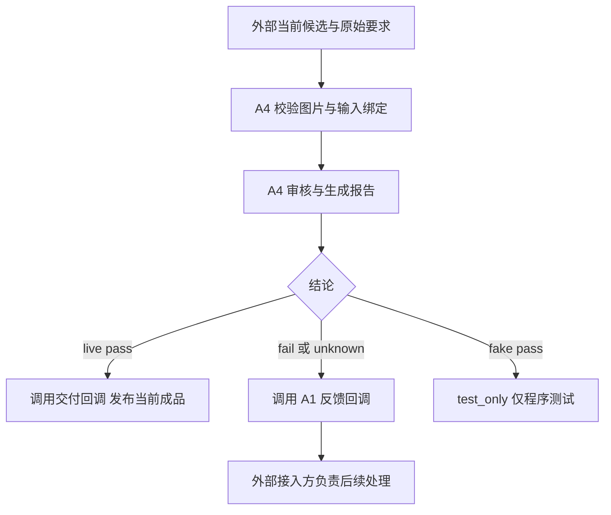

# A4 开发需求文档：当前进度、后续方向与详细接口

更新：2026-10-14。本次 A4 开发分支：`feature/dev-2026-10-14`；源码基线：`13b4b91d206e39f5538e85ead4499deee6e22ad9`。交付包含 A4 源码和专属文档，详细进度、后续顺序与所需资料见 [进度与交接](A4_PROGRESS_AND_NEXT_STEPS.md)。适用对象：A4 开发者和向 A4 提供输入、接收反馈的接入方。

**范围约束：你只开发 A4。本文中的项目总体进度仅供理解背景；所有后续开发任务、实现文件和验收都限定在 A4。A1/A2/A3、Renderer 和共享框架由其他负责人维护，本文不为它们制定开发方案，也不要求你修改它们。**

本文区分三种状态：**已实现**指当前源码存在；**已验证**指有实际运行或检查记录；**待开发**指仅为 A4 后续需求。拟议接口不等于已经注册或可调用的 API。

## 1. 当前结论与项目总体背景

**A4 已具备独立审核、真实图片校验、三态报告、自动分流、输入指纹、未知诊断和本地交付能力。本轮已新增 A4 框架输入/版本绑定、共享预算 Executor 和 Agent 输出包装，并通过受控离线接入验证。当前主要缺口是实际外部格式/查询/生产回调的真实联调，以及冻结版本的质量验证证据。**

P1 已实现结构化诊断、持久交付保护、绑定的渲染证据、实际 OCR 适配和冻结质量工具，macOS 原生 OCR 合成图接入已实测。P2 独立准备部分已完成实现与软件验证，接口见 [P1证据与质量](A4_P1_EVIDENCE_AND_QUALITY.md)和 [P2实施说明](A4_P2_IMPLEMENTATION.md)。实际 Renderer 格式/权威查询/生产回调和正式质量材料仍缺。

| 对象 | 当前仓库可确认的进度 | 限制与归属 |
|---|---|---|
| 项目要求 | 课程 Project 1：2–5 个关键词、720×1280 海报、3–4 个职责明确的 Agent、可靠通信 | 只作为 A4 输入/审核背景；不由 A4 改写项目架构 |
| 共享框架 | 四角色接口、格式转换、文件与版本引用、预算、工具、记录和四类返工路由已存在 | 当前默认工作流未改成所有 fail/unknown 都交给 A1；框架由其负责人维护 |
| A1 | 上述基线有 6 份探索性模型响应，来自 2 组关键词、3 个模型 | 样例说明明确不是批准的 schema 或完整 AgentOutput；不能据此声称真实 A1 已接通 |
| A2/A3 | 本仓库有设计资料和确定性演示 | 未核对组员其他分支/机器；本文不判断其个人完成度，也不安排其开发任务 |
| A4 | 独立模块及原接口/quickstart 已合入 main；本轮 P0 适配器在当前开发分支新增 | 真实 A1 消费及端到端生成/返工由外部提供；本轮不宣称已接通 |
| 本地软件验证 | 2026-10-14第二轮最终 A4 **1470 passed /97.85s**，框架 **136 passed /6.23s**，分别运行，共1606项；当前源码验证与冷进程检查范围见进度交接 | 软件行为验证；模型质量未验，测试未上传；详见本轮交付记录 |
| Linux源码验证 | 同一A4源码在Docker amd64/CPython3.11.17环境通过41项冷进程/迁移＋9项质量连接检查 | ARM主机仿真容器；不宣称原生性能、真实模型/OCR或正式wheel安装 |
| GitHub 交付 | PR #1 已合并为历史基线；本次发布上述 A4 开发分支。推送前查询远端 main 为 `fc64d89c431992abfa34346d93cf01b4ae89de8a` | 项目背景表描述基线快照；未盘点组员的新提交。只提交 A4 源码/文档，测试和依赖文件不上传；具体交付提交见分支历史 |
| A4 质量证据 | 有历史真实模型诊断、6 图开发参考及单份人工标签 | 没有当前冻结版本正式质量验收结论；不能把单次连通或 pass 当成一般准确率 |

课程指南第 2 页的说明段写有 specialized models，要求列表写 specialized agents；本文只记录原措辞，不自行增加“必须使用四个不同基础模型”的要求。课程具体截止日仍未确认，不以旧路线图的建议日期代替正式截止日。

### 1.1 A4 已完成的能力

| 能力 | 已实现/验证内容 | 主要源码 |
|---|---|---|
| 输入与图片 | 严格字段、2–5 关键词、ID 唯一、图片路径、真实解码、尺寸/格式/单帧/20 MiB 校验 | `contracts.py`、`adapters/local_input.py`、`dispatch.py` |
| 审核 | 原始关键词、硬约束、文字内容/可读性、视觉布局、声明框几何；输出 pass/fail/unknown | `checks.py`、`engine.py`、`policy.py` |
| 未知诊断 | 对象、疑点、缺失证据、A1 核实建议；不会把调用失败或无法辨认改写成确定图像缺陷 | `diagnostics.py` |
| 绑定与分流 | 完整输入指纹、审核中输入不变检查、报告/Provider/调用记录核对、两个 async 回调 | `identity.py`、`dispatch.py` |
| 本地输出 | 审核报告、计量、分流完成凭据；生产 pass 发布审过的 bytes，fail/unknown 保存候选和 A1 反馈 | `cli.py`、`reporting.py` |
| 模型与执行 | qwen/glm/minimax/compatible 配置分支、命名配置、有限重试、超时、传输/校验/计量记录 | `providers/chat.py`、`config.py`、`runtime.py` |
| 开发评估工具 | 数据预检、固定观察重放、HTML 复核、评估续跑与汇总 | `data.py`、`review.py`、`evaluate.py` |
| 本轮 P0 适配 | 显式格式/候选映射、原始要求保留、当前版本查询、共享预算、完整框架输出与绑定回调 | `adapters/framework_input.py`、`framework_executor.py`、`framework_agent.py` |
| 独立 P1 工具 | 诊断v1旁路/框架封装、配置账本后超时与去重/结果核对、局部证据、冻结Fake回放 | `structured_diagnostics.py`、`delivery.py`、`evidence.py`、`frozen_evaluation.py` |

“支持 profile”表示当前代码有相应适配，不表示本次确认了服务在线可用性、价格或额度。本次没有发起新的收费模型请求。

### 1.2 当前还不能声称完成的事项

- A4 包装器已在现有注册/单 Agent 入口离线验证，尚未用真实组员数据接入完整 `PosterWorkflow`，共享工作流未修改。
- 独立输入指纹仍只绑定审核内容；新 AuditBinding 另存 run/candidate/revision/完整依赖及来源查询绑定。查询的真实权威语义由显式接入函数提供，不能由输入包自行证明。
- `layout_geometry` 基线检查声明框；可选渲染证据层已核对实际 ink bounds、字形、文案和重叠事实。真实 Renderer schema 和权威查询尚未提供，不能将受控样例当作实际联调。
- `repair_hint` 可基于明确几何或绑定的实际渲染事实给出有限建议；没有通用 brief/asset 根因归因，OCR 冲突不生成猜测性修复操作。
- CLI 的 `awaiting_a1` 和回调的 `completed` 都不能证明真实 A1 已消费或完成修改。
- 配置同一持久 DeliveryGuard 账本后可跨输出路径去重、拒绝冲突并保存不确定交付状态；未配置时保留旧行为。仍没有外部消费 ACK、跨系统原子交付或整组文件事务。

## 2. A4 职责与固定行为

### 2.1 你负责的范围

- 审核外部提交的当前成品及原始要求，生成真实、可核对的报告。
- 提供和维护 A4 的输入归一化、版本/文件绑定、报告转换、Provider/Executor、诊断、交付及回调接口。
- 在 A4 目录内实现所需适配器和证据检查工具，编写 A4 测试、验证记录和文档。
- 保证错误、未知、消耗和停止原因不被隐藏，不为得到 pass 而删除要求或改标签。

允许的实现范围：`src/poster_critic/**`、`tests/quality_critic/**`、A4 专属文档和验证记录。不得顺带改动 `src/poster_framework/**`、组员模块或其业务协议；需要外部信息时记录为前置条件。

### 2.2 分流约定



| 情况 | A4 行为 | A4 不承担的工作 |
|---|---|---|
| 生产 pass | 验证报告与当前输入匹配，调用 `on_release`，输出已经审核的图片 | 不再要求 A1 批准；不重新生成一张未经审核的图 |
| fail | 返回已确认问题、证据、建议、保留要求及原始上下文 | 不直接修改其他模块的产物，不自行控制 A2/A3 |
| unknown | 返回对象、疑点、缺失证据、建议核实方向，暂不放行 | 不把未知写成错字、缺主体等确定缺陷，不盲目重生 |
| Fake pass | 返回 test_only，不调用交付或 A1 回调 | 不把固定观察当成真实图片质量证据 |
| 输入/执行错误 | 拒绝不合法输入或传播执行错误，保存已有调用消耗 | 不伪造审核 unknown，也不报告交付成功 |

“自动放行”仍建立在图片、完整输入指纹、报告语义和真实有效调用记录均合法的基础上。`pass` 可以含 minor 建议；blocking/major、必需检查失败或关键未知不能被 minor 抵消。

## 3. 外部只需向 A4 提供什么

本节是 **A4 的接入前置条件**，不是为其他模块制定开发任务或 schema。

| A4 需要的信息 | 来源 | A4 侧处理要求 |
|---|---|---|
| 原始关键词及稳定 ID、用户硬约束 | 原始请求/接入方 | 原样读取，不用下游 prompt 或设计说明重新推导 |
| 已确认文案、文案 ID、固定文字要求 | 接入方提供的当前版本 | 映射为 approved_copy；固定文字保持 exact |
| 当前实际采用的布局、元素/文案引用、坐标单位 | 接入方提供的布局数据 | 显式映射为最终画布 xyxy；没有时记录缺失 |
| 可解码最终成品、素材键与元素关系、可用渲染证据 | 接入方提供的候选数据 | 读取真实 bytes，不把 Manifest 声明当成像素事实 |
| 明确候选引用、运行身份、依赖版本、剩余预算 | 接入方/现有框架 context | A4 保存来源绑定，不由模型编造 ID、修订号或 hash |
| 两个 async 函数：交付函数、A1 接收函数 | 接入方 | A4 调用并等待；不实现函数背后的生成或返工逻辑 |

只缺一份上下文时，要明确到底是“没有提供”还是“确实不存在”；不得用空数组/空字符串伪装已完成核对。外部尚未提供真实样例时，A4 可以用本地受控输入开发和测试适配器，但不宣布真实联调完成。

### 3.1 接入前仍需明确的四项条件

| 条件 | 当前状态 | 对 A4 的影响 |
|---|---|---|
| 首份真实输入样例和字段说明 | 候选/revision、文案和布局引用的实际来源尚未确定 | A4 先维护受控样例；拿到已提供的格式后再实现对应映射，不代拟其他模块的业务 schema |
| 生产调用入口和接收函数 | 独立 dispatch 及新 QualityCriticAgent/AgentOutput 包装已实现，实际生产接收函数未提供 | 包装器会先完成相应回调再返回输出；默认框架对 unknown 仍结束为 needs_review，不能只凭返回 AgentOutput 判断 A1 已消费 |
| 当前候选及依赖版本的查询依据 | 尚未指定运行时/调用方的权威查询入口 | 同一包中的依赖快照只能证明包内一致；A4 需要与查询结果比较，才可声称拒绝了过期候选和依赖；缺少查询依据时不宣称完整版本核验或生产接入完成 |
| 冻结版模型质量验收门槛 | 指标可定义，数据分割及阈值尚未约定 | 离线验收前固定漏检、误 fail、unknown 等门槛；不临时编造准确率要求，也不增加每次生产审核的人工放行步骤 |

这些是 A4 的接入与验收条件，不是其他组员的开发需求；本文不会据此安排修改 A1/A2/A3 或共享框架。

## 4. 已实现输入接口

### 4.1 版本、类型与解析

| 层 | 当前版本/名称 | 用途 |
|---|---|---|
| 文件输入 | `LocalManifest`，`schema_version=1` | JSON + 图片文件 |
| 内存输入 | `AuditInputV1`，`schema_version=1` | 已归一化要求 + 实际图片 bytes |
| 审核报告 | `AuditReportV3`，`schema_version=3` | 质量结论与证据 |
| 回调结果 | `DispatchResult`，`schema_version=1` | 分流状态 + 输入 + 完整报告 |
| 模型配置 | 单模型 v1 / 模型目录 v2 | 选择 Provider，和报告版本无关 |
| 外部框架 | `interface_version="1.0.0"` | 运行身份、文件/版本/预算；不是 A4 JSON 的 schema_version |

所有 A4 `Contract`：禁止额外字段、严格类型、字段冻结、禁止非有限数。`Text` 要包含非空白字符；不会自动 trim。Python 内部集合为 tuple，JSON 中为数组；推荐用 `model_validate_json()` 解析 JSON。冻结字段不保证嵌套 JSON 字典递归不可变，分流仍要重校验并比较完整输入指纹。

### 4.2 LocalManifest 顶层字段

| 字段 | 类型 | 必填/默认 | 规则 |
|---|---|---|---|
| `schema_version` | 整数 1 | 可省略，默认 1 | 输入明确拒绝布尔值和其他版本 |
| `sample_id` | Text | 必填 | 本次候选审核标识；全局唯一性由接入方维护 |
| `keywords` | Keyword[] | 必填 | 2–5 项，keyword_id 不重复 |
| `user_constraints` | UserConstraint[] | 必填 | 允许 `[]`，constraint_id 不重复 |
| `required_checks` | CheckId[] | 可省略 | 默认四项基础检查，不能删除或重复 |
| `approved_copy` | CopyItem[] 或 null | 默认 null | copy_id 不重复；null 表示未提供，[] 表示没有列出的文案 |
| `design_context` | Text 或 null | 默认 null | 设计说明，不当作实际图像证据 |
| `layout_context` | LayoutContext 或 null | 默认 null | 若几何是必查但无布局，则 unknown |
| `asset_context` | AssetContext 或 null | 默认 null | 素材描述及关联，不自动证明素材根因 |
| `render_context` | RenderContext 或 null | 默认 null | 诊断说明，不是完整 RenderManifest |
| `image` | ImageLocation | 必填 | 仅接受下表的 path 对象 |

基础检查：`keyword_alignment`、`user_constraints`、`text_readability`、`layout_quality`。可增加 `text_accuracy`、`layout_geometry`。存在必需文案或 required_text 时自动加入 text_accuracy；可选检查发现已确认 major/blocking 问题仍会 fail。

### 4.3 输入嵌套对象

| 对象 | 必填字段 | 可省略字段/默认值 |
|---|---|---|
| `Keyword` | `keyword_id: Text`、`text: Text` | 无 |
| `UserConstraint` | `constraint_id: Text`、`name: Text`、`value: JSON value` | 无 |
| `CopyItem` | `copy_id: Text`、`text: Text` | `required=true`；`match_policy="exact"` |
| `LayoutContext` | `elements: LayoutElement[]` | 允许空数组，但不能只传 `{}` |
| `LayoutElement` | `element_id: Text`、`bbox_xyxy: 四个数` | `copy_id=null` |
| `AssetContext` | `assets: Asset[]` | 允许空数组，但不能只传 `{}` |
| `Asset` | `asset_key: Text` | `element_ids=[]`；`description=null` |
| `RenderContext` | 无 | `messages=[]`；每项为 Text |
| `ImageLocation` | `path: Text` | 无 |

- `UserConstraint.name` 当前不是枚举；`required_text` 的 value 必须是非空白字符串。没有宣称任意自定义约束都具备确定性校验器。
- `match_policy=exact` 使用 NFC 后比较；`typographic` 额外统一现有规则中的空白、大小写、部分引号和连字符，不修复拼写、数字、同形字或零宽字符。用户固定文字用 exact。
- `bbox_xyxy=[x0,y0,x1,y1]` 为最终 720×1280 画布像素，原点左上、x 向右、y 向下；xywh 应转换为 `[x,y,x+width,y+height]`。归一化框必须先明确来源语义和画布，再显式换算。
- 输入 Schema 允许越界/反序声明框，供程序报告几何问题；不要静默裁剪，也不要把“所有越界在加载阶段拒绝”写成当前行为。
- element_id、asset_key 各自唯一；目前未完整验证所有跨对象引用关系，A4 适配器应补充 copy_id/element_ids 来源与引用核对。
- LocalManifest 不接收 `run_id`、`candidate_id`、Brief/Spec 版本、完整上游 JSON 或预算对象；框架接入时这些信息另存 A4 AuditBinding 和实际执行 context，不改变本地输入合同。

### 4.4 图片文件与内存输入

```python
audit = load_input("a4_input.json")  # 返回 AuditInputV1
```

`load_input(path: str | Path) -> AuditInputV1`：图片相对路径基于 JSON 所在目录，读取真实内容，校验单帧 PNG/JPEG、720×1280、≤20 MiB、完整解码，计算 SHA-256。

| `ImagePayload` 字段 | 必填/默认 | 含义 |
|---|---|---|
| `data: bytes` | 必填，非空 | 实际已加载图片；不进入 JSON/model_dump |
| `media_type` | 必填 | image/png 或 image/jpeg |
| `width`、`height` | 默认 720、1280 | 只接受固定值；dispatch 还核对实际解码尺寸 |
| `sha256` | 必填 | 64 位小写 SHA-256，必须与 data 匹配 |

**required_text 特例：** load_input 会增加 `copy_id="constraint:<constraint_id>"` 的必需 exact 文案，并拒绝同 ID 冲突。直接构造 AuditInputV1 不经过这个补全步骤；新 build_audit_input 已在 A4 侧做同等归一化，不能漏掉用户固定文字。

共享框架可接受 WebP，但当前 A4 不接受。P0 先明确拒绝并返回具体格式错误；如未来在 A4 增加转换，必须保留原图 hash、转换后 hash 和来源关系，不修改 A3 原图。

完整输入示例见附录 A，实际字段已按当前模型校验。

## 5. 已实现输出接口

### 5.1 AuditReportV3 顶层

| 字段 | 类型 | 必填/默认 | 语义 |
|---|---|---|---|
| `schema_version` | 整数 3 | 默认 3 | 当前报告版本 |
| `sample_id` | Text | 必填 | 被审核样本 |
| `image_sha256` | Text | 必填 | dispatch 要求等于实际输入图 hash |
| `input_fingerprint` | SHA-256 或 null | 默认 null | 旧报告可省略读取；新报告填写，dispatch 必须匹配 |
| `decision` | pass/fail/unknown | 必填 | 业务结论，见下方规则 |
| `keyword_checks` | KeywordCheck[] | 必填，2–5 项 | 每个原始关键词的判断 |
| `constraint_checks` | ConstraintCheck[] | 必填，可空 | 每个硬约束的判断 |
| `text_checks` | TextCheck[] | 必填，可空 | 转录、准确性和可读性 |
| `coverage` | Coverage[] | 必填 | 六项检查均出现且 ID 不重复 |
| `issues` | Finding[] | 必填，可空 | 已记录的问题和建议 |
| `uncertainties` | Text[] | 必填，可空 | 对象、疑点、缺失证据和下一步 |
| `repair_hint` | RepairHint 或 null | **必填，可 null** | 修复提示，不是命令 |
| `model`、`prompt_version` | Text | 必填 | Provider 名称与提示版本；当前 prompt 为 critic-v4 |
| `execution_mode` | fake/live | 必填 | 与框架 real/fake 枚举分开 |
| `calls` | CallRecordV2[] | 必填 | 当前审核的尝试记录 |
| `vision_calls` | 非负整数 | 必填 | 等于 calls 中 live=true 的尝试数 |

`input_fingerprint()` 覆盖归一化后的要求、文案、检查项、设计/布局/素材/渲染上下文及图片 hash；同图换要求也会改变指纹。它不是 run/candidate 的身份或完整工作流版本。旧报告不能在消费时补算一个当前指纹再自动放行。

### 5.2 检查、问题与提示对象

| 对象 | 字段与必填性 |
|---|---|
| KeywordCheck | keyword_id、status、evidence 全必填 |
| ConstraintCheck | constraint_id、status、evidence 全必填 |
| TextCheck | copy_id、observed_text、status、readability 全必填；observed_text 可 null |
| Coverage | check_id、required、state、status、reason 全必填；status 可 null |
| Finding | code、severity、evidence、suggestion、source 必填；element_id、bbox_xyxy 默认 null |
| RepairHint | stage、reason、preserve 必填；element_id、asset_key 默认 null |

枚举：

- `status/readability`：pass/fail/unknown。
- `Coverage.state=assessed` 时 status 为 pass/fail；unknown 时为 unknown；not_assessed 仅用于非必需未检查项，status=null。
- `severity`：blocking/major/minor；`source`：program/model。source 不等于已经定位根因。
- `stage`：brief/layout/asset/render；当前 policy 仅生成 layout 提示，条件是明确声明几何错误、没有未知覆盖/全局不确定项及 blocking 问题。
- 模型原始问题框必须在画布内；程序 Finding 可保留越界框，便于解释声明几何错误。找不到位置时用 null，不能编 ID 或坐标。

V3 的结论顺序：**已确认必需失败或 blocking/major → fail；否则关键证据不足或全局 uncertainties → unknown；否则 pass。** fail 可同时带未知诊断；不确定时不得强行生成 hint。仅可选准确性 unknown 且其他关键项通过时，可能仍 pass，该未知仅写 coverage.reason。

`observed_text=null` 表示没有可靠转录；`""` 可表示明确未出现文字的观察，但识别器空结果本身不是缺字证明。`parse_report()` 保留 V1/V2 的原始语义用于历史读取，新的自动分流只接收 V3。

### 5.3 unknown 的交付要求

代码当前自动生成：

```text
检查对象：<keyword_id / constraint_id / copy_id / 检查项或执行阶段>
疑点：<已记录的观察或尚未完成的核对>
缺失证据：<缺少什么才可确认>
建议：<A1 可核实/补充的下一步>
```

对象覆盖关键词、硬约束、文字、可读性/布局、缺正式文案/布局、缺 required_text 映射、无有效模型观察及模型声明不确定项。AuditReportV3 仍保留字符串数组和 coverage.reason，不改原 schema；新 structured_diagnostics(audit, report) 返回独立 DiagnosticsEnvelopeV1，从 typed checks/coverage/calls 推导对象，不解析中文字符串。CLI 可写诊断旁路文件，框架在 review.details.diagnostics 中提供。

例如：“copy_id=title 无法可靠转录；缺少当前成品文字观察；建议核对文字参数并取得可读证据后重审”。这不等于“标题有错字”。无有效观察时说明审核没完成及 calls 错误原因，不凭空推测图像瑕疵。

### 5.4 传输、校验与计量记录

| CallRecordV2 字段 | 必填/默认 | 规则 |
|---|---|---|
| attempt、model、live、elapsed_ms | 必填 | attempt≥1，elapsed_ms≥0 |
| status | 必填 | ok/invalid_response/error |
| transport_status | 必填 | succeeded/failed |
| validation_status | 必填 | pending/valid/invalid/not_run；最终报告不能含 pending |
| billing_status | 必填 | not_applicable/usage_reported/unknown |
| usage | 默认 null | 有值时含非负 input_tokens/output_tokens |
| error_type | 默认 null | 错误类型，不写密钥或原始错误响应 |
| request_id、response_model、finish_reason、http_status | 默认 null | 传输元数据 |
| usage_details | 默认 {} | token 细分，不重复计入总输出 token |

HTTP 成功不等于 JSON/语义有效，也不等于审核通过。没有 usage 不能伪补零；billing unknown 保留未知状态。

## 6. 已实现调用与交付接口

### 6.1 审核核心和回调签名

以下为签名说明，函数体省略；使用时导入现有实现。

```python
class AuditEngine:
    def __init__(self, provider: Provider, executor: Executor, *,
                 max_retries: int = 1, retry_delay: float = 0.5,
                 max_retry_delay: float = 5.0) -> None: ...

    async def audit(self, audit: AuditInputV1) -> AuditReportV3: ...

async def audit_and_dispatch(
    audit: AuditInputV1,
    engine: AuditRunner,
    *,
    on_release: Callable[[DispatchResult], Awaitable[None]],
    on_feedback: Callable[[DispatchResult], Awaitable[None]],
    delivery: DeliveryGuard | None = None,
    candidate_identity: str | None = None,
) -> DispatchResult: ...
```

两个回调均必填、为 async，接收同一种结果。AuditRunner 具有 provider 和 async audit。Provider/Executor 的详细边界见第 7 节。不要从调用方再加隐藏重试层。

### 6.2 DispatchResult v1

| 字段 | 必填/默认 | 内容 |
|---|---|---|
| schema_version | 默认 1 | 分流封装版本 |
| route | 必填 | release/a1/test_only |
| action | 必填 | release_candidate/return_to_a1/test_only |
| recipient | **必填，可 null** | a1 时 creative_director，其他为 null |
| handler_status | 必填 | pending/completed/not_called |
| report | 必填 | 完整 AuditReportV3 |
| audit | 必填 | 完整 AuditInputV1；内存含 bytes，JSON 不含 bytes |
| input_fingerprint | 必填 | 本次输入的64位小写 SHA-256 |

| 情况 | route/action | 回调 | 返回状态 |
|---|---|---|---|
| live pass | release / release_candidate | await on_release 一次 | completed |
| fake pass | test_only / test_only | 两个都不调用 | not_called |
| fail 或 unknown | a1 / return_to_a1 | await on_feedback 一次 | completed |

回调收到 pending；completed 仅表示函数返回成功，不代表 A1 已读、已修改或已生成。回调异常/取消向上传播，副作用可能部分发生，A4 不自动重试，也不返回假成功。

可选 delivery 参数接入持久 DeliveryGuard；completed 重复、in_flight/uncertain 和报告冲突会拒绝新交付，不标成新完成。candidate_identity 默认 sample_id；框架包装采用 run/candidate/revision。账本与期限接口见 P1本地工具，未配置时保留原调用行为。

Fake fail/unknown 同样会调用 on_feedback；离线验证必须传测试接收函数，不能误接真实 A1。只有 Fake pass 跳过两个回调。

分流前核验：真实图片、完整输入指纹、sample/image、全部 keyword/constraint/copy IDs、必查集合、Provider/调用身份；审核中输入或 Provider 变化会拒绝。live pass 还必须有有效成功 live 记录。字节发布使用 `result.audit.image.data`，不能重新读一个可能已被替换的原路径。

最小接入用法（external 函数由调用方提供，不是 A4 替它们实现业务）：

```python
from poster_critic.adapters.local_input import load_input
from poster_critic.dispatch import audit_and_dispatch

audit = load_input("a4_input.json")
result = await audit_and_dispatch(
    audit, configured_engine,
    on_release=external_publish,
    on_feedback=external_a1_handler,
)
```

### 6.3 CLI 参数与退出码

| 参数 | 必填/默认 | 约束 |
|---|---|---|
| --input、--out | 必填 | LocalManifest 文件、新报告路径；输出禁止覆盖 |
| --provider | 默认 fake | fake/chat |
| --response | fake 可选 | 默认与输入同名的 .observation.json；chat 不接受 |
| --config | chat 必填 | 不含密钥的配置；fake 不接受 |
| --model | 可选 | 目录 alias，不是模型 ID；单模型 v1 不能用 |
| --attempts | 默认 2 | 仅1或2 |
| --timeout | 默认30秒 | 有限数，(0,600] |
| --total-timeout | 默认90秒 | 有限数，(0,600]，用于请求与重试 |
| --input-price、--output-price | 可选 | 每百万token价格，成对提供且有限/非负 |
| --currency | 提供价格时必填 | 用于估算，不是账单 |
| --structured-diagnostics | 默认关闭 | 写独立V1诊断旁路；原A1包字段不变 |
| --delivery-ledger | 默认 null | 所有需共同去重的调用使用同一SQLite路径；与输入/输出族及journal路径分开 |
| --handler-timeout | 配置ledger时默认30秒 | 有限正数；单独提供会拒绝；与模型timeout分开 |

退出码：正常完成任何质量结论均为 0；CLI 捕获的执行错误为 2，KeyboardInterrupt 为 130；其他异常可直接传播。不能只靠退出码判断通过。具体捕获范围见第 7.3 节。

设 O 为 --out 路径：

| 产物 | 条件/含义 |
|---|---|
| O | 正常审核的 AuditReportV3 |
| O.usage.json | 计量；已有消耗的执行错误也尽量保存 |
| O.dispatch.json | 正常分流最后写入；release/a1 在回调成功后写入，Fake pass 无回调，记录 test_only/not_called |
| O.poster.png/jpg | 仅 live pass：已审核成品 |
| O.candidate.png/jpg、O.a1.json | fail/unknown：候选快照和 awaiting_a1 包 |
| O.error.json | 已有调用记录的执行错误；没有调用时可能没有此文件 |
| O.diagnostics.json | --structured-diagnostics：完整DiagnosticsEnvelopeV1 |
| O.delivery.json | 配置ledger：此次交付结果或失败/被拒绝时已有记录；Fake pass无生产交付收据 |
| 隐藏 lock 文件 | 输出族 POSIX 锁；不是跨路径业务幂等 |

各文件单独原子创建，整组不是事务。失败可能保留报告/计量/部分图片；没有成功 dispatch 凭据不能声称整组交付完成。错误之后不要直接覆盖或自动重放同一个输出族。

### 6.4 文件交付包的精确字段

| 产物 | 字段 |
|---|---|
| A1 反馈包 | schema_version=1、recipient=creative_director、status=awaiting_a1、candidate_path、input_fingerprint、audit、report |
| 分流收据 | schema_version=1、route、action、recipient、handler_status、sample_id、image_sha256、input_fingerprint、report_path、execution_mode、status、image_path、feedback_path |
| 计量包 | live_attempts、attempts_with_unknown_usage、reported_input_tokens、reported_output_tokens、currency、known_usage_cost_estimate、total_cost_estimate、note |
| 执行错误包 | kind=execution_error、error_type、calls |

A1/收据路径当前为本机绝对路径，image_path/feedback_path 可为 null；status 为 released/awaiting_a1/test_only。feedback 包没有 handler_status 或消费 ACK。JSON 中 audit.image 仅有图片元数据，不能直接当完整 AuditInputV1 再验证或调用；应从 candidate_path 读取实际 bytes 并核对 hash。复制到另一台机器时本机绝对路径可能失效，需要 A4 交付适配处理，不能要求其他模块猜路径。

## 7. A4 模型与执行边界

### 7.1 Provider 与 Executor

```python
from collections.abc import Awaitable, Callable
from typing import Protocol

class Provider(Protocol):
    name: str
    live: bool

    async def invoke(self, audit: AuditInputV1, prompt: str) -> ModelResponse: ...

class Executor(Protocol):
    @property
    def records(self) -> tuple[CallRecordV2, ...]: ...

    async def execute_once(
        self, invoke: Callable[[], Awaitable[ModelResponse]], *, model: str, live: bool
    ) -> ModelResponse: ...

    def record_validation(self, attempt: int, *, error_type: str | None) -> None: ...

    async def wait_before_retry(self, delay: float) -> None: ...
```

ModelResponse：text 必填；usage/request_id/response_model/finish_reason/http_status/problem 默认 null；usage_details 默认 {}，refusal 默认 false。Provider 只返回观察和传输信息，不决定 pass/fail/unknown、返工或发布。

StandaloneExecutor：max_attempts=2（1或2）、allow_live=false、request_timeout=30秒、total_timeout=90秒、on_update=null。on_update 若提供，为同步函数，接收 `(started_attempts, records)`，在请求意图与记录更新时调用。不能并发共享同一个 executor。

engine 最多一次重试/修正，默认等待0.5秒、最大可接受等待5秒；refusal 不继续重试。传输/用量在观察解析前保存。total_timeout 不包括回调时间；P1 DeliveryGuard 提供独立回调期限与持久去重，需显式配置。

### 7.2 ProviderConfig 与配置目录

| 字段 | 必填/默认 | 当前规则 |
|---|---|---|
| schema_version | 默认1 | 单模型配置 |
| profile | 默认 qwen | qwen/glm/minimax/compatible |
| base_url、model | 必填 | HTTPS base，不含凭据/query/fragment或/chat/completions；端口默认/443 |
| api_key_env | 默认 A4_API_KEY | 合法环境变量名；密钥不进入 JSON |
| response_format | 默认 json_object | json_object/json_schema/prompt_json |
| max_output_tokens | 默认1200 | 整数128–8192 |
| timeout_seconds | 默认30秒 | (0,300]，同时受 executor timeout 限制 |
| output_token_parameter | 默认 null | max_tokens/max_completion_tokens |
| thinking_mode | 默认 null | 按profile允许 disabled/enabled/adaptive/omit |
| reasoning_effort | 默认 null | low/medium/high/xhigh/max；当前仅 minimax 的 MiniMax-M3.1-Flash-Preview 支持 |

ModelCatalog：schema_version 默认2；active_model 和非空 models 字典必填；alias 为1–64位字母/数字/下划线/连字符，active_model 必须存在。--model 指 alias。

当前 GLM/MiniMax 用 prompt_json；compatible 不定义 vendor thinking 标记，仅允许 null/omit。其他 profile 特定限制以 [chat.py](../src/poster_critic/providers/chat.py) 为准；不把源码的模型白名单等同服务商当前承诺。

真实 Provider 使用盲转录：隐藏预期文字及 required_text 值，程序再本地比较。design_context/asset_context/render_context 不直接送入当前视觉请求；它们不能使模型“照着声明认定图片正确”。网络适配单次 POST、无隐藏传输重试、不跟随重定向；当前成功响应体上限2 MiB。

### 7.3 错误分类

| 类别 | 当前类型/行为 | A4 保留什么 |
|---|---|---|
| 输入不合法、hash/版本绑定错误 | InputError，审核/交付前拒绝 | 具体安全错误说明，不伪装为图片 unknown |
| 模型观察JSON/ID/语义不合法 | ResponseError，有限修正后可形成unknown | calls 校验状态、对象/缺证据诊断 |
| 可重试超时或传输故障 | RetryableProviderError，有限重试 | 已发起尝试及可能消耗，不能清零 |
| 不可恢复服务/配置故障 | ProviderError，上抛执行错误 | 安全错误类型/请求信息，不回显key或响应body |
| 预算不足 | BudgetExceededError，不绕过预算 | 未发起/已发起的区别和已有计量 |
| 交付/A1回调故障 | 原异常/取消上抛，不重试副作用 | 不返回 completed；核心 executor.records 保留已有记录，是否落盘取决于调用方 |
| 受保护交付重复/冲突/未知/超时 | DeliveryError子类，作为执行/交付错误拒绝 | 原receipt/不确定状态，已有调用保留；不伪装为图像unknown或新完成 |

CLI 捕获 InputError、ProviderError、BudgetExceededError、DeliveryError、OSError、ValueError 和 KeyboardInterrupt；有调用记录时尝试写 error/usage 文件，配置账本后另保存已有交付receipt。一般 RuntimeError、TypeError、asyncio.CancelledError 等仍可直接传播，调用方需保存已有 executor.records 和账本状态。写文件本身失败时也不能承诺保存成功。

## 8. 开发优先级与本轮状态：只属于 A4

### P0：A4 接入当前来源、版本与预算

| ID | A4 任务 | A4 产物 | 完成条件 | 本轮状态 |
|---|---|---|---|---|
| A4-P0-01 | 将已提供的外部格式归一化到 AuditInputV1 | `adapters/framework_input.py` | 原词/顺序/约束保留；required_text补齐；坐标和引用验证；未知格式拒绝 | 显式 decoder 机制已实现/离线验证；真实组员格式映射待样例 |
| A4-P0-02 | 保存并核对候选运行时绑定 | AuditBinding、当前来源查询及重验 | 不猜候选；真实 bytes；旧候选/混合声明依赖拒绝；报告和指纹保留 | 已实现/离线验证；生产查询权威及完整导出来源需明确 |
| A4-P0-03 | 框架执行适配器 | `adapters/framework_executor.py` | 每次尝试经context.call_model；失败/重试计量；拒绝不发请求 | 已实现/离线验证，含非法用量元数据和限额故障 |
| A4-P0-04 | 报告映射与 Agent 包装 | `adapters/framework_agent.py` | 审核身份及全部keyword；合法路由；不改共享enum/工作流 | 已实现/离线验证；A1模式action/target均null，完整hint保留 |
| A4-P0-05 | A4输入/反馈故障测试 | 三份test_framework_*.py | 原始要求、文案、hash/版本、unknown、预算、回调失败确定预期 | 新增114项通过；不是实际团队联调或模型质量验收 |

这些工作可先以受控 context/来源样例测试。外部真实引用、格式说明、handler 尚未到位时，标为“外部前置条件缺失”，不代为实现其他 Agent，也不假装完成真实联调。

### P1：A4 证据、诊断消费与交付可靠性

| ID | A4 任务 | 约束/验收 | 本轮状态 |
|---|---|---|---|
| A4-P1-01 | 实际渲染证据与文字/框一致性 | 只读Manifest，不实现Renderer；缺证据保持unknown | A4归一化/显式decoder/current-source/ink/text/glyph/overlap已实现；真实格式待提供 |
| A4-P1-02 | 局部证据/OCR | 原图hash、坐标映射、单独证据类型 | 裁剪与Tesseract/Apple Vision有界适配及可选二次检查已实现；原生OCR已实测，真实海报识别质量未验 |
| A4-P1-03 | 结构化未知诊断 | 保留字符串/原结论，不猜根因/执行命令 | DiagnosticsEnvelopeV1、CLI旁路及框架字段已实现 |
| A4-P1-04 | 回调期限、去重和结果核对 | 不自动重放可能已有副作用的handler，不伪造ACK | 配置共享SQLite账本后可用；不确定状态需调用方明确外部证据 |
| A4-P1-05 | 冻结版本与质量验证 | 保留失败分母，不混成绩 | 冻结/核验/回放/独立标签与约定门槛工具已实现；正式真实模型实验与材料未完成 |

### P2：在 P0/P1 完成后再考虑

详细任务、接口、执行顺序和验收边界见 [A4 P2 详细开发需求](A4_P2_DEVELOPMENT_REQUIREMENTS.md)。统一实验身份、遥测、模型级发送前校验、连接生命周期、文字政策测试和源码复现工具已实现，实际调用与软件验证见 [实施说明](A4_P2_IMPLEMENTATION.md)。生产审核行为的改变仍须满足相关 P1 证据与质量门槛；真实联调、模型质量与复用收益未验收。

- A4 自身的性能/成本优化、更多 Provider profile、额外语言和文字类型覆盖。
- 完善独立 A4 分发与换机复现；如需改共享 pyproject/uv.lock，另由仓库负责人决定，不自动修改本轮保留的依赖变更。
- 如有实测需求，再开放更多证据格式与高级修复提示；不新增生产 Supervisor、不训练布局/生图模型，不接管 A1/A2/A3。

不按旧路线图日期承诺完成时间。建议顺序：先 A4 来源绑定和Executor，再证据/交付恢复，最后冻结版验证；每项达到完成条件后再扩展。

## 9. A4 侧适配接口（本轮已实现）

本节只描述 A4 包装层。它消费显式映射的来源格式，不为 A1/A2/A3 定义或修改业务 schema。完整签名、默认值、回调包、调用样例和限制见 [A4框架接入说明](A4_FRAMEWORK_INTEGRATION.md)。

### 9.1 输入适配签名与私有绑定

```python
# 本轮已实现；类型及函数从 poster_critic.adapters.framework_input/agent 导入
def build_audit_input(agent_input, context, mapping) -> tuple[AuditInputV1, AuditBinding]: ...

def to_framework_output(report: AuditReportV3, binding: AuditBinding) -> AgentOutput: ...
```

| AuditBinding 保存的内容 | 来源/规则 |
|---|---|
| run_id、A4 invocation身份、输入ContentFormat | 已提供metadata/context；不由模型编造 |
| 明确candidate引用及revision | 接入方或已登记candidate记录；不能拿files[0]猜 |
| 原始请求及keyword/constraint映射 | 读取原始记录；framework约束仅name/value，A4侧生成稳定constraint_id并保存映射 |
| 实际参与审核的version_dependencies | 使用现有artifact_id/revision，保存本次依赖快照 |
| 当前候选/依赖查询结果及查询来源 | 从运行时或调用方明确提供的权威入口读取，与候选/revision/依赖快照比较；不能由同一输入包自行证明“最新” |
| 文案/布局/素材本地ID映射 | 记录外部字段到copy_id/element_id/asset_key，不把它们冒充artifact_id |
| 原始文件hash、A4图像hash、input_fingerprint | 按真实bytes计算并核对；若转换需保存来源关系 |
| 可用证据引用 | 保存实际声明的依赖/候选；缺失保持缺失 |

剩余预算从每次调用的现有 RunContext 查询/准入，不用旧预算快照代替共享运行时。稳定 constraint_id 算法、输入格式解码和 sample_id 规则见接入说明。

稳定 constraint_id 应依据当前run/原始位置/约束内容按明确算法生成并保留映射；仅用name字典会吞掉同名多条约束。冻结算法及测试，不写入其他模块的原始请求。

包内 ID/revision/hash 匹配只证明内部一致；“当前版本”必须有外部查询依据。A4 在读取和交付前都核对该依据，防止审核期间候选被替换。查询入口或查询语义缺失时明确返回接入错误，不自动声称完整版本核验。

### 9.2 A4 可以读取的现有框架接口

| 已存在的接口 | A4 使用范围 |
|---|---|
| AgentInput | content、content_format、metadata必填；provenance默认null；业务content结构由外部提供 |
| FrameworkMetadata | identity、original_request必填；interface_version=1.0.0；含version_dependencies/files/usage/budget |
| OriginalRequest | 原始keyword_id/text/position、name/value约束、画布；A4不改其内容 |
| VersionDependency | artifact_id/revision两个非空字符串，是真实产物身份 |
| FileReference | file_id/run_id/uri/revision/sha256/media_type，没有purpose或role |
| ArtifactReference | artifact_id/run_id/revision/role/uri/sha256/media_type，purpose及source_id；明确candidate用途 |
| context.files.read(ref) | 从同run已登记引用读取，运行时验证路径、版本与hash |
| context.call_model(..., kind=critic_vision) | A4共享预算入口，实际失败调用仍计量 |

当前 metadata.files 可先列assets再列candidate；不能靠数组位置或文件名猜图。默认图仍可能对unknown直接结束为needs_review；这是外部运行限制，A4文档不会安排你改它。

### 9.3 输出映射约束

`AgentOutput.content` 保留完整A4报告；`content_format` 使用接入时明确注册的A4报告格式。`review` 使用当前ReviewRecord：

- 填当前真实candidate_id/candidate_revision，关键词结果完整覆盖原始ID。
- pass/fail/unknown按实际报告映射，不将unknown改为fail以触发路由。
- action只随fail出现，且必须有真实VersionDependency target；无可靠根因/目标时两者都为null。
- element_id=title不等于框架artifact_id。当前四动作的合法目标分别为Brief记录、Layout记录、指定asset、当前candidate；A4适配器只核对和表达，不执行其业务修改。
- 只有A4返回审核record，reviewer身份由现有注册/运行时核验；不能把A1任务选择伪装成A4重新审核。

本轮 QualityCriticAgent 使用 A1 统一协调模式：外层 action/target 都为空，repair_hint 留在完整报告内，避免回调后共享框架再直接返工一次。on_feedback 接收框架绑定包；独立 audit_and_dispatch 仍保留旧 DispatchResult 回调。后续A2/A3执行和新候选生成不是A4交付范围。

### 9.4 FrameworkExecutor 的要求

- 实现第7节当前Executor协议，向现有context.call_model提供真实Provider/模型/调用信息；A4包装内不直接用StandaloneExecutor绕开共享预算。
- 统一一个重试层；每次实际请求、失败、无效观察和复核均进入真实计量。
- 保存本地CallRecordV2的transport/validation/billing关系，同时保留外部runtime事件引用；不能重复扣同一次调用，也不能漏记重试。
- 区分“预算拒绝未发起”与“发起后失败/用量未知”；未发起不能伪称收费尝试。
- 遵守外部现有预算：返工4轮、图像操作5次、Critic视觉5次、模型/工具100次。A4只消费自己的视觉/模型/工具额度，不重置预算或修改默认值。
- 预算不足仍保存已有证据/消耗并返回安全错误；不会在额度耗尽后再调用模型求一个pass。

## 10. A4 验收清单

| 验收ID | 场景 | 必须观察到的A4结果 |
|---|---|---|
| AC-01 | 正常live pass | 交付回调一次，bytes/hash匹配，A1回调零次 |
| AC-02 | fail | 完整报告/上下文到反馈回调一次，不发布通过成品 |
| AC-03 | 文字无法可靠转录 | unknown，copy_id定位、缺证据和建议；不捏造错字/major；hint=null |
| AC-04 | 无有效模型观察 | 说明审核未完成与calls原因，不能猜图片瑕疵 |
| AC-05 | Fake pass | test_only，两个生产回调零次 |
| AC-06 | 非PNG/JPEG、错尺寸、超限、多帧、坏图 | 模型调用和交付前拒绝 |
| AC-07 | 同ID/同图换文案、关键词、约束、布局 | 指纹不符，两个回调零次；旧报告仍可读取但不自动使用 |
| AC-08 | 审核中输入或Provider改变 | 拒绝分流，不能用新输入给旧结果贴标签 |
| AC-09 | 已知fail同时关键unknown | fail保留、诊断保留、hint为空 |
| AC-10 | required_text、重复ID、额外字段 | 固定文案归一化并严格核验；非法输入拒绝 |
| AC-11 | assets排在candidate前、旧引用/跨run/hash错、当前版本查询缺失 | 已实现适配器明确选候选，与显式查询结果核对并拒绝无效/过期声明；缺查询依据则接入错误 |
| AC-12 | 共享预算只剩0/1次、传输重试 | 已实现FrameworkExecutor不超额，实际尝试和未知用量不丢失 |
| AC-13 | 回调异常或取消、发布中途失败 | 没有假completed收据，不自动重试副作用，已有计量保留 |
| AC-14 | 多次/不同路径提交同一候选 | 配置共享DeliveryGuard后识别重复/冲突/未知，拒绝重复副作用；未配置不声称全局去重 |
| AC-15 | 附录全部示例与Schema | 完整输入/报告合法，节选与生成结果一致，拟议接口明确不声称可调用 |
| AC-16 | 非法响应用量/元数据，或重复创建Executor | 实际消耗仍有合法记录；本地上限不被绕过；关联键包含executor_id，不混淆同invocation请求 |
| AC-17 | 交付超时/取消/进程退出或拒绝取消 | 保存in_flight/uncertain，不按时间自动重放；外部明确证据才可核对结果 |
| AC-18 | 原报告兼容/结构化unknown | 原结论、原字符串与calls保留；subject_id来自typed字段，不靠中文解析 |
| AC-19 | 伪造局部图/改坐标/改父要求 | 元数据、hash、真实父图像素和坐标同时验证，拒绝不一致 |
| AC-20 | 冻结数据/代码/配置漂移或固定观察失败 | 拒绝篡改；失败留分母；software_demo_only，不宣称真实质量通过 |

软件层必须全部通过后才讨论模型质量。本地合成故障可由A4独立制作；它们不能替代真实图片上的语义/美学质量证据。

第二轮最终软件验证共1606项通过（A41470、框架136，分开运行），新增 Tesseract producer/私有执行快照、两客户端质量政策、同次遥测、历史档案重验和 benchmark 质量连接。当前源码包在本机 macOS arm64/CPython3.11 做仓库外冷进程与迁移检查，结果见本轮计划和 `continuation2_delivery_receipt.json`；上轮41项烟测和12次Fake记录保留为上轮快照证据。真实Renderer/权威查询/生产消费和正式质量材料仍缺。历史wheel构建收据不代表当前P1/P2源码的正式发行；本轮不修改依赖元数据，只交付可核验源码。

现有6张开发参考可继续复用；不要求另一位标注者重复填写，也不按A4结果修改已有标签。扩展开发/验证数据与门槛时，应固定数据分割、标签来源、模型/提示/代码版本；自动评价只能标明“模型代理评价”，不能宣称独立人工金标准。已有24图正式验证计划属于建议，当前尚未执行，不承诺一般准确率。模型质量指标的具体阈值尚未约定，需在冻结版离线验证前确定；当前软件验收表不替代这项质量验收。

## 11. 附录：可校验输入和输出

以下为协议/程序示例，不是组员成品或新的真实模型实验。完整输入可保存为a4_input.json，同目录放符合要求的poster.png。JSON示例由当前模型及离线观察校验。

### A. 完整 LocalManifest v1

<!-- generated-input-example -->

```json
{
  "schema_version": 1,
  "sample_id": "requirements-demo-001",
  "keywords": [
    {
      "keyword_id": "kw-coffee",
      "text": "咖啡"
    },
    {
      "keyword_id": "kw-plants",
      "text": "植物"
    }
  ],
  "user_constraints": [],
  "image": {
    "path": "poster.png"
  },
  "required_checks": [
    "keyword_alignment",
    "user_constraints",
    "text_readability",
    "layout_quality",
    "text_accuracy",
    "layout_geometry"
  ],
  "approved_copy": [
    {
      "copy_id": "title",
      "text": "COFFEE & PLANTS",
      "required": true,
      "match_policy": "exact"
    }
  ],
  "design_context": "协议演示，不是真实模型评价。",
  "layout_context": {
    "elements": [
      {
        "element_id": "title",
        "copy_id": "title",
        "bbox_xyxy": [
          40,
          90,
          680,
          180
        ]
      },
      {
        "element_id": "hero",
        "copy_id": null,
        "bbox_xyxy": [
          40,
          240,
          680,
          1120
        ]
      }
    ]
  },
  "asset_context": {
    "assets": [
      {
        "asset_key": "hero_image",
        "element_ids": [
          "hero"
        ],
        "description": "咖啡与植物主视觉"
      }
    ]
  },
  "render_context": {
    "messages": []
  }
}
```

<!-- end-generated-input-example -->

### B. 完整 AuditReportV3（Fake unknown）

这一报告来自固定观察与程序诊断。keywords中的可见证据仅为Fake示例；不作为模型质量结论。elapsed_ms为本次离线程序记录，不能作为真实模型延迟。

<!-- generated-report-example -->

```json
{
  "schema_version": 3,
  "sample_id": "requirements-demo-001",
  "image_sha256": "c11316293daae3b65d3c0a4419eb255beb3a738823b863b125927a5cc1467ca0",
  "input_fingerprint": "a4be916c17f790fda0ca79bab0a1587e0dd4db5d0fe0e9da016586c88569837d",
  "decision": "unknown",
  "keyword_checks": [
    {
      "keyword_id": "kw-coffee",
      "status": "pass",
      "evidence": "画面中央有杯子图形。"
    },
    {
      "keyword_id": "kw-plants",
      "status": "pass",
      "evidence": "杯子附近有绿色叶片。"
    }
  ],
  "constraint_checks": [],
  "text_checks": [
    {
      "copy_id": "title",
      "observed_text": null,
      "status": "unknown",
      "readability": "unknown"
    }
  ],
  "coverage": [
    {
      "check_id": "keyword_alignment",
      "required": true,
      "state": "assessed",
      "status": "pass",
      "reason": "Based on the recorded checks."
    },
    {
      "check_id": "user_constraints",
      "required": true,
      "state": "assessed",
      "status": "pass",
      "reason": "Based on the recorded checks."
    },
    {
      "check_id": "text_readability",
      "required": true,
      "state": "unknown",
      "status": "unknown",
      "reason": "检查对象：copy_id=title / text_accuracy、text_readability；疑点：文字无法可靠转录，尚不能判断文字准确性、正常观看时的可读性；缺失证据：能够核对当前成品文字准确性、正常观看时的可读性的可靠文字观察；建议：A1 核对 A2/A3 的文字参数与当前实际渲染，取得可读证据后重新审核，再判断是否需要改文案或渲染\n检查对象：text_readability；疑点：该视觉检查尚未确认；记录的观察：固定测试观察中标题未能可靠辨认。；缺失证据：可核对的成品视觉证据；未确认元素位置时不指定位置；建议：A1 核实当前成品与该疑点，取得可辨认证据后重新审核，再决定是否安排 A2/A3 修改"
    },
    {
      "check_id": "layout_quality",
      "required": true,
      "state": "assessed",
      "status": "pass",
      "reason": "Based on the recorded checks."
    },
    {
      "check_id": "text_accuracy",
      "required": true,
      "state": "unknown",
      "status": "unknown",
      "reason": "检查对象：copy_id=title / text_accuracy、text_readability；疑点：文字无法可靠转录，尚不能判断文字准确性、正常观看时的可读性；缺失证据：能够核对当前成品文字准确性、正常观看时的可读性的可靠文字观察；建议：A1 核对 A2/A3 的文字参数与当前实际渲染，取得可读证据后重新审核，再判断是否需要改文案或渲染"
    },
    {
      "check_id": "layout_geometry",
      "required": true,
      "state": "assessed",
      "status": "pass",
      "reason": "Based on the recorded checks."
    }
  ],
  "issues": [],
  "uncertainties": [
    "检查对象：copy_id=title / text_accuracy、text_readability；疑点：文字无法可靠转录，尚不能判断文字准确性、正常观看时的可读性；缺失证据：能够核对当前成品文字准确性、正常观看时的可读性的可靠文字观察；建议：A1 核对 A2/A3 的文字参数与当前实际渲染，取得可读证据后重新审核，再判断是否需要改文案或渲染",
    "检查对象：text_readability；疑点：该视觉检查尚未确认；记录的观察：固定测试观察中标题未能可靠辨认。；缺失证据：可核对的成品视觉证据；未确认元素位置时不指定位置；建议：A1 核实当前成品与该疑点，取得可辨认证据后重新审核，再决定是否安排 A2/A3 修改"
  ],
  "repair_hint": null,
  "model": "fake-fixed-v1",
  "prompt_version": "critic-v4",
  "execution_mode": "fake",
  "calls": [
    {
      "attempt": 1,
      "model": "fake-fixed-v1",
      "live": false,
      "status": "ok",
      "elapsed_ms": 0.02,
      "usage": null,
      "error_type": null,
      "transport_status": "succeeded",
      "validation_status": "valid",
      "billing_status": "not_applicable",
      "request_id": null,
      "response_model": null,
      "finish_reason": null,
      "http_status": null,
      "usage_details": {}
    }
  ],
  "vision_calls": 0
}
```

<!-- end-generated-report-example -->

### C. CLI 收据字段示例

这是收据结构示例，路径使用占位符；没有真实A1消费者，不表示A1已修改。嵌套audit/report见完整报告和第6.4节，不把收据当审核报告解析。

<!-- generated-receipt-example -->

```json
{
  "schema_version": 1,
  "route": "a1",
  "action": "return_to_a1",
  "recipient": "creative_director",
  "handler_status": "completed",
  "sample_id": "requirements-demo-001",
  "image_sha256": "c11316293daae3b65d3c0a4419eb255beb3a738823b863b125927a5cc1467ca0",
  "input_fingerprint": "a4be916c17f790fda0ca79bab0a1587e0dd4db5d0fe0e9da016586c88569837d",
  "report_path": "/RUN_DIR/report.json",
  "execution_mode": "fake",
  "status": "awaiting_a1",
  "image_path": "/RUN_DIR/report.json.candidate.png",
  "feedback_path": "/RUN_DIR/report.json.a1.json"
}
```

<!-- end-generated-receipt-example -->

## 12. 依据和下一项可执行工作

当前接入字段以[输入输出接口](QUALITY_CRITIC_TEAM_CONTRACT.md)、[快速使用](QUALITY_CRITIC_QUICKSTART.md)及源码为准：

- [输入/输出模型](../src/poster_critic/contracts.py)、[文件归一化](../src/poster_critic/adapters/local_input.py)
- [判定规则](../src/poster_critic/policy.py)、[未知诊断](../src/poster_critic/diagnostics.py)
- [分流与真实图/指纹校验](../src/poster_critic/dispatch.py)、[指纹](../src/poster_critic/identity.py)
- [CLI交付](../src/poster_critic/cli.py)、[文件/计量](../src/poster_critic/reporting.py)
- [Provider协议](../src/poster_critic/ports.py)、[Executor](../src/poster_critic/runtime.py)、[Chat配置/传输](../src/poster_critic/providers/chat.py)
- 外部只读依据：[框架公开类型](../src/poster_framework/types.py)、[框架调用计量](../src/poster_framework/runtime.py)、[A1样例说明](../examples/creative-director-samples/README.md)
- 课程依据：本地 `MAIE5421_CourseProject_Guidelines.pdf` 第2页；历史模型诊断/标签在本地 evaluation/quality_critic，未把旧模型结果作为当前版本成绩。

Pydantic语义核对来自 [官方模型说明](https://docs.pydantic.dev/latest/concepts/models/) 与 [配置API](https://docs.pydantic.dev/latest/api/config/)：冻结并不递归冻结字典，已有实例也不能默认当作重新验证过。本项目因此主动重校验和指纹绑定。

**当前仅做A4：完成并核验P2独立工具与源码交付；后续拿到真实格式/查询/生产回调再做实际接入，冻结独立标签及正式阈值后运行质量实验。详见 [P2实施说明](A4_P2_IMPLEMENTATION.md)，固定观察回放不作正式质量验收。**
